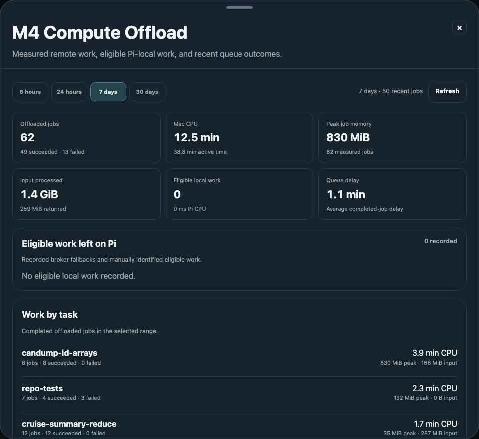

# van-compute

`van-compute` owns the coupled Pi broker and Mac worker for guarded offline compute jobs. Deployment source paths intentionally retain their historical repository-relative layout because installed and frozen releases fingerprint those paths.

## Dashboard



The read-only M4 Compute pane reports offloaded work, resource totals, queue
outcomes, and retained job diagnostics. The pane is hosted by the sibling
Van Dashboard in `scripts`; this repository owns the broker, worker, metrics,
and API data behind it.

## Test

From the repository root, using Python 3.11+, zsh for the installer smoke test,
and the pinned test requirement:

```zsh
python3 run_tests.py
```

`requirements-test.txt` is the test dependency contract. The compute task passes
an offline wheelhouse to `python3 run_tests.py --wheelhouse PATH`; the runner
installs it into a temporary target without changing the interpreter environment
or using the network. The suite does not require a sibling `scripts` checkout.

## Deploy

Read [`pi/docs/compute/VAN_COMPUTE.md`](pi/docs/compute/VAN_COMPUTE.md) before deploying. Review the local-only plan first:

```zsh
./macbook/scripts/install_van_compute_worker.zsh --dry-run
```

Run a live install only from the owner's regular Terminal after reviewing the checkout:

```zsh
./macbook/scripts/install_van_compute_worker.zsh
```

Routine monorepo updates continue through `/Users/jacobr/dev/scripts/pi/sync_scripts.sh`, which invokes this checkout with `--if-needed` after its package updates.
